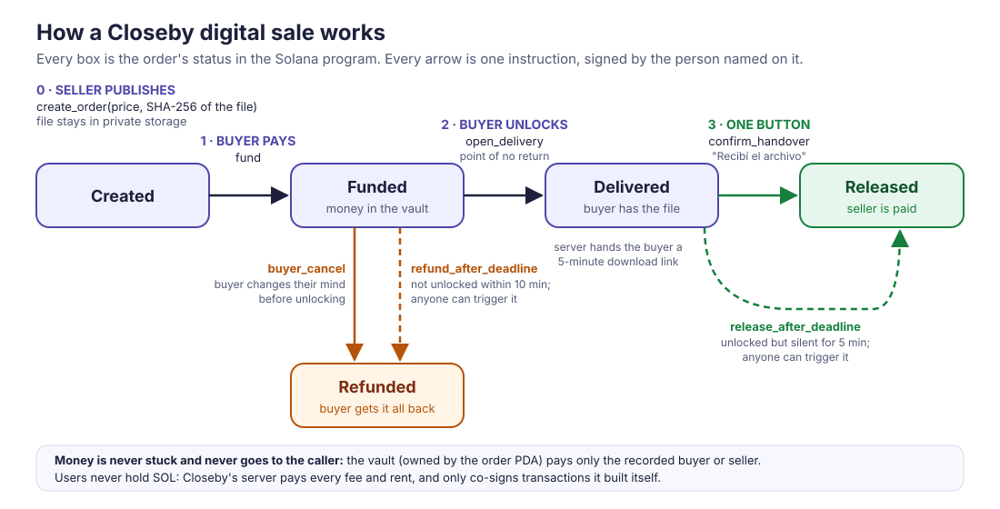
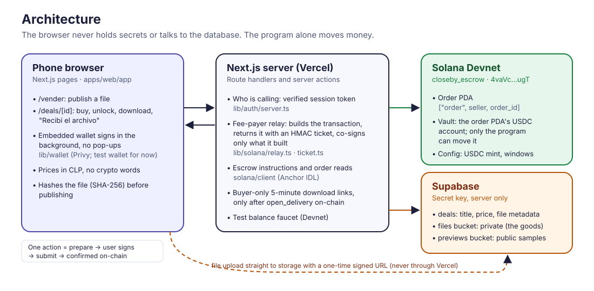

# Closeby

**Sell a file to a stranger without either side having to trust the other.** The buyer pays first, the money waits in a Solana escrow that nobody can touch, and the seller is paid the moment the buyer presses one button: *"Recibí el archivo"*. If something goes wrong, fixed on-chain rules send the money back. Users log in like any app, see prices in Chilean pesos, and never see a wallet, a seed phrase or a gas fee.

Built for the **Dev3pack Hackathon (Solana)**, Santiago hub, 27–29 November 2026.

| | |
| --- | --- |
| **Live demo** | _TBD: Vercel URL_ |
| **Video** | _TBD_ |
| **Program (Devnet)** | [`4vaVcMbVh5czXPMw3w6FCp8AFjNNuVtaquppq6ZEzugT`](https://explorer.solana.com/address/4vaVcMbVh5czXPMw3w6FCp8AFjNNuVtaquppq6ZEzugT?cluster=devnet) |

---

## The problem

Freelancers and creators in Chile sell digital work to people they meet on Instagram, WhatsApp or marketplaces: beats, photos, design files, reports, video edits. Every sale starts with the same standoff:

- **Pay first?** The buyer risks paying a stranger and getting nothing, or the wrong file.
- **Send the file first?** The seller risks the buyer downloading it and disappearing.

Today they solve it with trust, screenshots of transfers, or by not selling at all. Card escrow services are built for shops, not for two people in a chat, and their fees and onboarding kill small sales.

## Who it is for

- **Sellers** of digital goods (producers, photographers, designers, analysts) who want to get paid for every file they deliver.
- **Buyers** who want a refund guarantee until they actually have the file.
- Both of them **without crypto knowledge**: a normal login, prices in CLP, one button to close the deal.

## How it works



1. **The seller publishes** the file at `/vender`. It goes to private storage; only its SHA-256 goes on-chain (`create_order`), as public proof of what is being sold. A public preview (audio clip, watermarked image) shows what it is.
2. **The seller shares a link** (or QR) to `/deals/[dealId]`.
3. **The buyer pays** (`fund`): the exact price moves into a vault owned by the order's PDA. Until they unlock the file, they can cancel and get everything back.
4. **The buyer unlocks the file** (`open_delivery`): the point of no return, confirmed on screen first. Only now does our server hand them a 5-minute download link.
5. **The buyer presses "Recibí el archivo"** (`confirm_handover`): the vault pays the seller. Done.

The rules that keep money from getting stuck:

| Situation | Outcome | Who can trigger it |
| --- | --- | --- |
| Buyer cancels before unlocking | Full refund to the buyer | Buyer |
| Buyer paid but never unlocked within 10 min (demo window) | Full refund to the buyer | **Anyone** |
| Buyer unlocked the file and stayed silent for 5 min (demo window) | Seller is paid | **Anyone** |
| Buyer unlocked the file and is unhappy | No refund in this version: unlocking is the point of no return, and the preview exists so the buyer can judge first | — |

Whoever triggers a deadline action, the money only ever goes to the recorded buyer or seller, never to the caller.

## Solana integration

### The program: `closeby_escrow` (Anchor)

Source in [`solana/programs/closeby_escrow/src`](solana/programs/closeby_escrow/src), one module per instruction.

| Account | Address | Holds |
| --- | --- | --- |
| `Config` | PDA `["config"]` | Admin, the only accepted mint (test USDC), claim and review windows |
| `Order` | PDA `["order", seller, order_id (u64 LE)]` | Seller, buyer, amount, kind, file SHA-256, status, deadlines |
| Vault | Associated USDC account of the `Order` PDA | The escrowed money. No private key exists: only the program can move it |

| Instruction | Signer | Rule | Effect |
| --- | --- | --- | --- |
| `init_config` | Program upgrade authority only | Once | Sets the mint and windows. Nobody can front-run it to become admin |
| `create_order` | Seller | Amount > 0, non-zero file hash, configured mint | `Created`, empty vault |
| `fund` | Buyer | `Created`, buyer ≠ seller | Price → vault; claim deadline starts; `Funded` |
| `open_delivery` | Buyer | `Funded`, before the claim deadline | Review deadline starts; `Delivered` |
| `buyer_cancel` | Buyer | `Funded` (not yet unlocked) | Vault → buyer; `Refunded` |
| `confirm_handover` | Buyer | `Delivered` | Vault → seller; `Released` |
| `refund_after_deadline` | Anyone | `Funded`, claim deadline passed | Vault → buyer; `Refunded` |
| `release_after_deadline` | Anyone | `Delivered`, review deadline passed | Vault → seller; `Released` |

Every rule is a `require!` with a custom error (`NotBuyer`, `ClaimWindowClosed`, `DeadlineNotReached`, `WrongMint`, `WrongTokenAccount`…), every state change emits an event, token movements use checked transfers, and payout accounts are validated against the recorded buyer or seller. **27 tests** cover the happy path, both refunds, the review-window payout and every case that must fail, asserting that failed operations leave balances unchanged ([`solana/tests`](solana/tests)).

### Invisible wallet and fees paid by us

Users never hold SOL and never see a signing pop-up:

- **Embedded wallet**: each user gets a Solana keypair behind a normal login (`apps/web/lib/wallet`). Screens only use the `Wallet` interface, so the provider can change without touching them ([decision 0003](docs/decisions/0003-invisible-wallet.md)).
- **Fee-payer relay** ([`apps/web/lib/solana/relay.ts`](apps/web/lib/solana/relay.ts)): for every action our server builds the transaction with our fee payer and returns it unsigned with an **HMAC ticket** over the message. The user's wallet signs it in the background, and the server co-signs **only if the message is byte-for-byte what it built and the logged-in user signed it** ([`ticket.ts`](apps/web/lib/solana/ticket.ts), tested against tampering such as a transfer that would drain the fee payer). Then it sends the transaction and waits for confirmation.
- **Client**: [`solana/client`](solana/client) builds every instruction from the IDL (`accountsStrict`) and reads orders in the web's shape; the web uses it from server code only.

One action, end to end: `POST /api/escrow/prepare` → user signs → `POST /api/escrow/submit` → confirmed on Devnet → the page re-reads the order on-chain. A wallet callback alone is never shown as "paid".

### Why Solana

Sub-cent fees make a $5.000 CLP sale viable, finality in about a second makes "press the button, the seller is paid" feel instant, and a program-owned vault replaces trust in a middleman with rules anyone can read.

## Architecture



- **Web**: Next.js 16 (App Router) in [`apps/web`](apps/web), mobile first, Chilean Spanish, no crypto words on screen.
- **Off-chain data**: Supabase for titles, prices, previews and the files themselves. The browser never talks to the database: only server code, with the secret key ([decision 0001](docs/decisions/0001-supabase-server-only.md)). Files are uploaded straight to private storage with one-time signed URLs, and the server re-hashes them and compares with the order's on-chain hash before publishing.
- **On-chain**: the escrow program on Devnet, with our own 6-decimal SPL token as test USDC.
- **Server checks**: who is calling comes from a verified session token, never from an address in the request; downloads go only to the order's on-chain buyer after `open_delivery`; a preview identical to the file is rejected.

## Tracks and partner integrations

| Track | Why Closeby fits |
| --- | --- |
| **Solana: Best App Overall** | A complete consumer app on Devnet: own Anchor program, real users' flow end to end, no wallet or SOL needed by users |
| **Solana: Best DeFi App** | Programmable, trust-minimized payments between two strangers (below) |
| **Supabase** | Database, private and public storage, signed URLs and server-only access, all tied to the on-chain state (below) |

### Solana: DeFi

Closeby is a **payment primitive**: a two-party escrow where settlement is enforced by the program, not by a company holding the money.

- **Funds move only by rule**: buyer → vault on `fund`, vault → seller on `confirm_handover` or after the review window, vault → buyer on `buyer_cancel` or after the claim window. There is no admin withdrawal and no instruction that sends money to the caller ([`instructions/release.rs`](solana/programs/closeby_escrow/src/instructions/release.rs), [`instructions/refund.rs`](solana/programs/closeby_escrow/src/instructions/refund.rs), [`rules.rs`](solana/programs/closeby_escrow/src/rules.rs)). On Devnet the program is still upgradeable by the team; before real money its upgrade authority would be moved to a multisig or revoked.
- **Money is never stuck**: every funded state has a deadline that anyone can execute, so settlement does not depend on either party staying online.
- **Accessible**: sub-cent fees, paid by our relay so users need no SOL ([`apps/web/lib/solana/relay.ts`](apps/web/lib/solana/relay.ts)); prices shown in CLP; checked SPL transfers of a USDC-like token.
- **Composable**: the order and vault are PDAs any client can read, and the IDL is published ([`solana/idl/closeby_escrow.json`](solana/idl/closeby_escrow.json)).

### Supabase

Supabase holds everything that must not go on-chain: listings, the files being sold and their previews. Solana stays the source of truth for money; Supabase is only trusted after the server checks it against the chain.

| What | How | Where |
| --- | --- | --- |
| **Postgres: `deals`** (title, price in CLP, file metadata, preview URL) | Saved only after the server verifies the on-chain order exists with this seller, amount and file hash | [`supabase/migrations/0001_deals.sql`](supabase/migrations/0001_deals.sql), [`0003_digital_goods.sql`](supabase/migrations/0003_digital_goods.sql), [`apps/web/lib/deals.ts`](apps/web/lib/deals.ts), [`apps/web/app/vender/actions.ts`](apps/web/app/vender/actions.ts) |
| **Server-only access** | RLS on, every privilege revoked from `anon` and `authenticated`; only server code with the secret key (`import 'server-only'`) reaches the data. Verified: the publishable key cannot read or write anything | [`0002_server_only_access.sql`](supabase/migrations/0002_server_only_access.sql), [`apps/web/lib/supabase.ts`](apps/web/lib/supabase.ts), [decision 0001](docs/decisions/0001-supabase-server-only.md) |
| **Storage: private `files` bucket** (the goods) | Browser uploads straight to Storage with a one-time **signed upload URL** (files never pass through Vercel). The server then downloads the stored file, **re-computes its SHA-256 and compares it with the `content_hash` on-chain** before publishing | [`apps/web/lib/storage.ts`](apps/web/lib/storage.ts), [`apps/web/app/vender/actions.ts`](apps/web/app/vender/actions.ts) |
| **Storage: signed download URLs** | A 5-minute link, served as an attachment, only to the order's on-chain buyer after `open_delivery` | [`apps/web/app/api/deals/[dealId]/download/route.ts`](apps/web/app/api/deals/%5BdealId%5D/download/route.ts) |
| **Storage: public `previews` bucket** | Samples the buyer sees before paying; a preview identical to the sold file is deleted and the sale refused | [`apps/web/app/vender/actions.ts`](apps/web/app/vender/actions.ts) |

## Deployed on Devnet

| Item | Value |
| --- | --- |
| Program ID | [`4vaVcMbVh5czXPMw3w6FCp8AFjNNuVtaquppq6ZEzugT`](https://explorer.solana.com/address/4vaVcMbVh5czXPMw3w6FCp8AFjNNuVtaquppq6ZEzugT?cluster=devnet) |
| Config PDA | [`GgvJPDvGh58K2x4b3afCnsqP9Y556MkKVHWaEfh9Tyem`](https://explorer.solana.com/address/GgvJPDvGh58K2x4b3afCnsqP9Y556MkKVHWaEfh9Tyem?cluster=devnet) |
| Test USDC mint (6 decimals) | [`9REWY6ZAJbt6UaH1nLetb6i7tApvLWzr9m3TSo5ZCnkz`](https://explorer.solana.com/address/9REWY6ZAJbt6UaH1nLetb6i7tApvLWzr9m3TSo5ZCnkz?cluster=devnet) |
| Fee payer (pays users' fees and rent; mint authority of the test token) | [`DhuJTzRRuLLHdHt5BsreqvZR9i8qiskVktprDsUF64BA`](https://explorer.solana.com/address/DhuJTzRRuLLHdHt5BsreqvZR9i8qiskVktprDsUF64BA?cluster=devnet) |
| Upgrade authority | `J2m4KAUHetgikUpGYgGVtDw7tuhKVXzgcouTycjJavix` |
| Demo windows | Claim 600 s, review 300 s |
| IDL | [`solana/idl/closeby_escrow.json`](solana/idl/closeby_escrow.json) |

Full deployment record (transactions, slots, toolchain): [docs/program-plan.md](docs/program-plan.md#deployment-record).

## Try it

On the live demo (or locally), with two browsers, for example a normal and a private window:

1. **Buyer window**: press **Entrar** on the home page, then **Cargar saldo de prueba** (500 test USDC ≈ $475.000 CLP; no real money).
2. **Seller window**: press **Entrar**, go to **Vender**, upload a file and a short preview, set a price and publish. Copy the link.
3. **Buyer window**: open the link and press **Comprar con pago protegido**, then **Desbloquear archivo**, **Descargar archivo** and **Recibí el archivo: pagar al vendedor**.
4. **Seller window**: the sale page updates by itself to "✅ Te pagaron".
5. Press **Ver comprobante** to open the transaction on Solana Explorer (Devnet).

Try the other paths too: cancel before unlocking, or wait out a window and use the deadline buttons.

## Run locally

Requirements: Node.js 24, pnpm (version pinned in `package.json`) and a Supabase project. For the program: Rust, Solana CLI 3.1.10 and Anchor CLI 1.2.2.

```sh
pnpm install --frozen-lockfile
cp apps/web/.env.example apps/web/.env.local   # then fill it in, see below
pnpm --filter @closeby/web dev                  # http://localhost:3000
```

**Supabase** (once): enable the Data API with `public` exposed, then run these in the SQL Editor, in order: [`0001_deals.sql`](supabase/migrations/0001_deals.sql), [`0002_server_only_access.sql`](supabase/migrations/0002_server_only_access.sql) and [`0003_digital_goods.sql`](supabase/migrations/0003_digital_goods.sql).

**Environment** (`apps/web/.env.local`, and the same in Vercel for Production and Preview; all server-only except `NEXT_PUBLIC_ESCROW_MODE`):

| Variable | Value |
| --- | --- |
| `SUPABASE_URL` | Supabase project URL |
| `SUPABASE_SECRET_KEY` | Supabase secret key (`sb_secret_...`). Never `NEXT_PUBLIC_` |
| `ESCROW_MODE`, `NEXT_PUBLIC_ESCROW_MODE` | `chain` for the program on Devnet; `mock` for an off-chain stand-in that applies the same rules (no Solana needed). Same value in both |
| `SOLANA_RPC_URL` | `https://api.devnet.solana.com` |
| `USDC_MINT` | The mint the program's config was initialized with (table above) |
| `FEE_PAYER_SECRET_KEY` | Base58 secret key of the fee payer. Must be that mint's authority |
| `WALLET_MODE` | `mock` (default): test users with a Devnet keypair kept in the browser. `privy` once the provider is wired in |
| `MOCK_AUTH_SECRET`, `RELAY_TICKET_SECRET` | Optional; derived from the Supabase key and the fee payer by default |

To create your own fee payer and test mint instead, run `pnpm --filter @closeby/web setup:devnet`. It writes them to `.env.local`; if the airdrop is refused, fund the printed address at https://faucet.solana.com. A new mint needs its own program deployment and `init_config`, because the config is locked to one mint.

**Program**:

```sh
pnpm --filter @closeby/solana build         # anchor build --arch v0
pnpm --filter @closeby/solana test          # 27 tests on a local validator
pnpm --filter @closeby/solana smoke:devnet  # create → fund → unlock → confirm on Devnet, users without SOL
```

**Web checks** (also run in CI on every pull request):

```sh
pnpm --filter @closeby/web typecheck
pnpm --filter @closeby/web test    # escrow rules, download rule, session tokens, relay tampering
pnpm --filter @closeby/web build
```

## Repository

| Path | What |
| --- | --- |
| [`apps/web`](apps/web) | Next.js app: pages, server routes, wallet, relay, escrow client glue |
| [`solana`](solana) | Anchor program, tests, IDL and the TypeScript client |
| [`supabase/migrations`](supabase/migrations) | Database schema and access rules |
| [`docs`](docs) | Product rules, flows, program contract, plan and decision records ([start here](docs/README.md)) |

## Status and next steps

- **Working on Devnet**: the full digital flow above, with users who hold no SOL.
- **Login**: the demo uses test accounts with a real Devnet keypair kept in the browser. Privy (Google or email login with an embedded wallet) plugs in behind the same `Wallet` interface. Pollar was evaluated and ruled out because its managed Solana wallets cannot sign custom program instructions ([decision 0003](docs/decisions/0003-invisible-wallet.md)).
- **Next**: in-person sales on the same program ([proposal](docs/in-person-proposal.md)), disputes with a mediator, real USDC with a CLP on-ramp, and fresh keys and an audit before any mainnet use.

## Team

Martín (web and server), Diego (web design and wallet), Aaron and Alex (Solana program).
